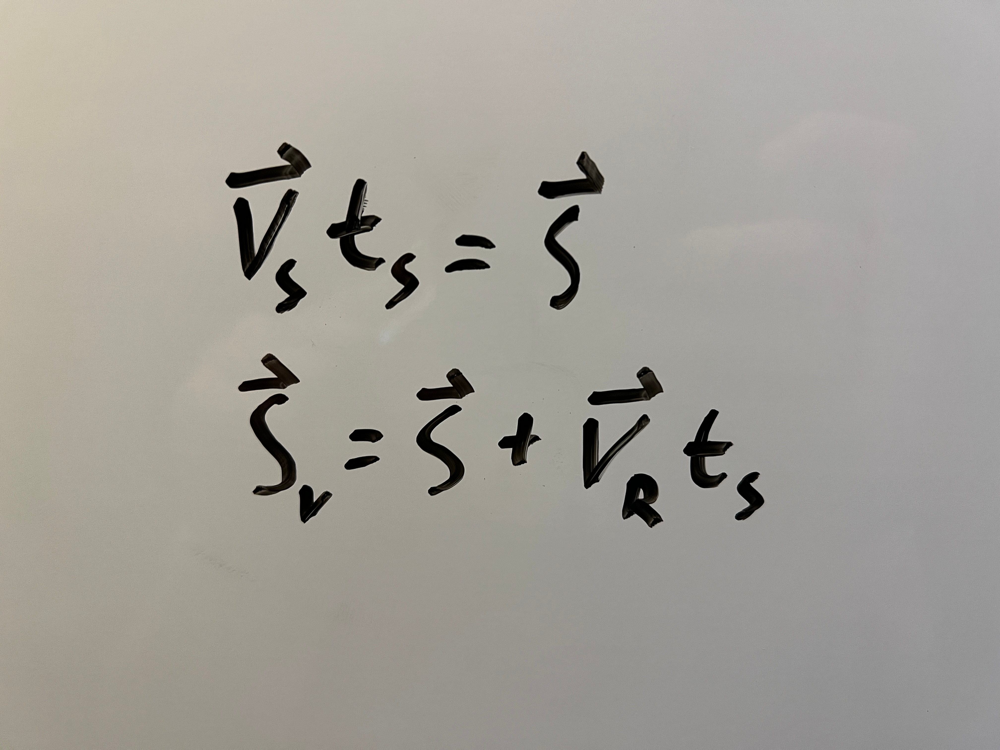
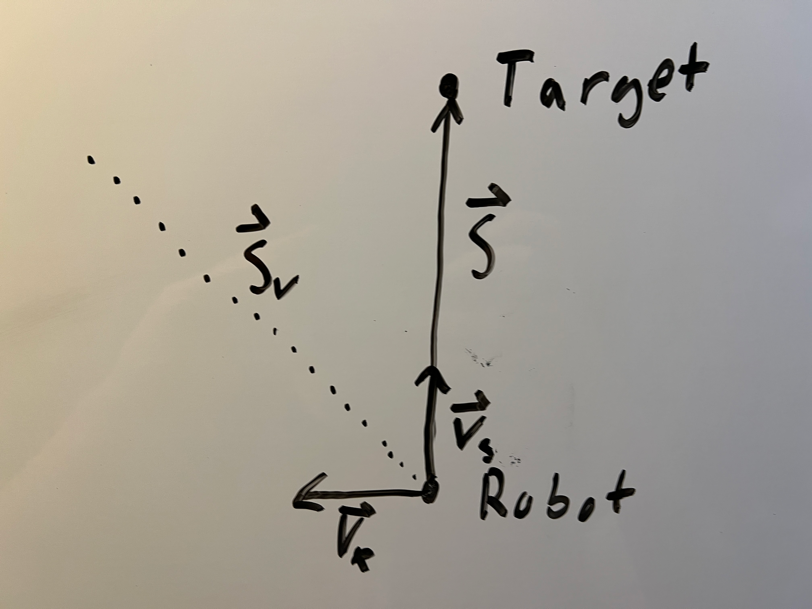
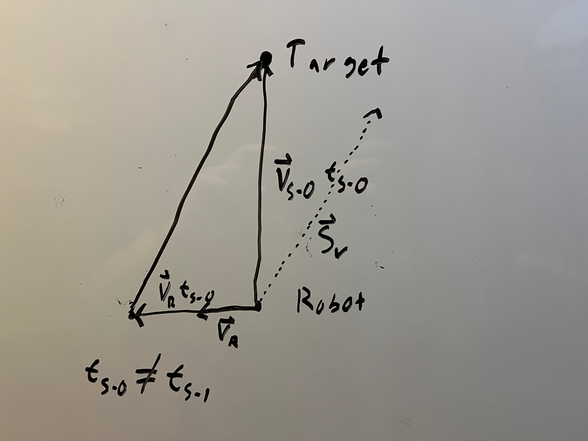
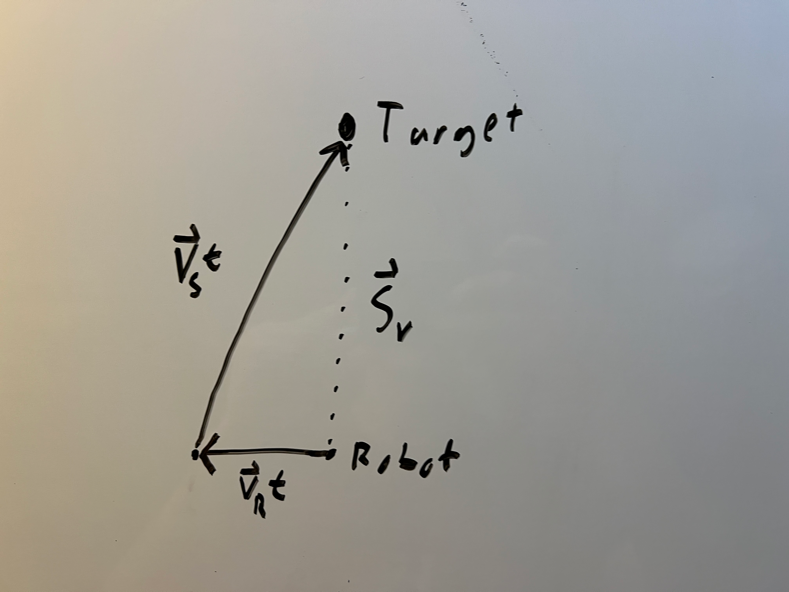
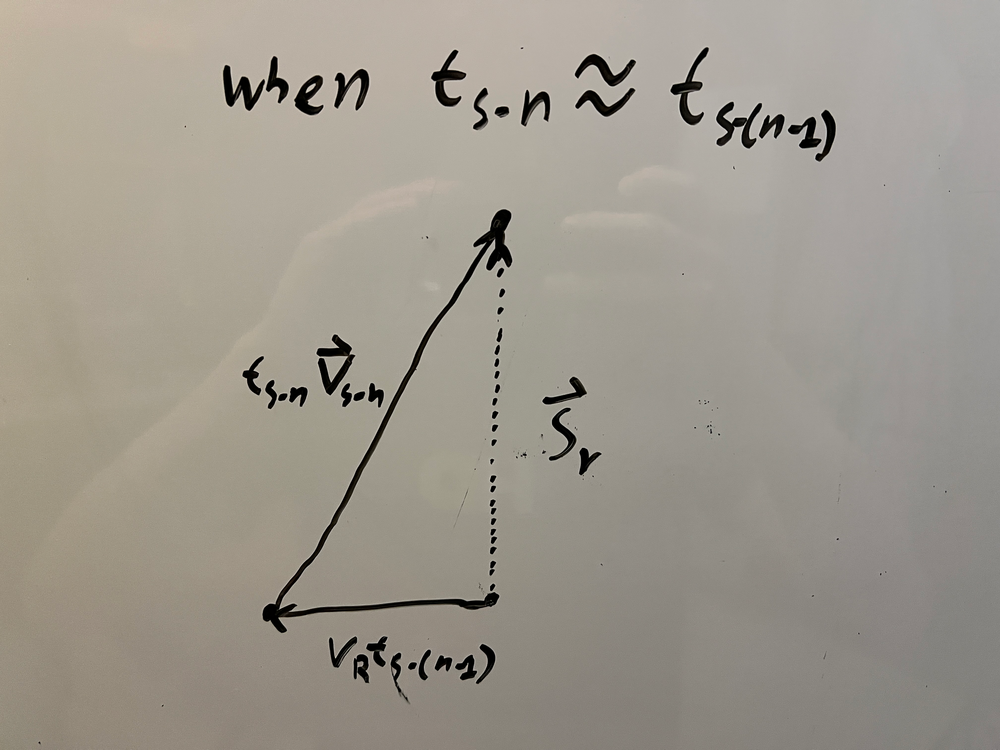
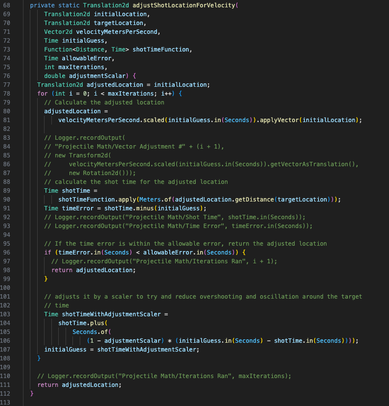
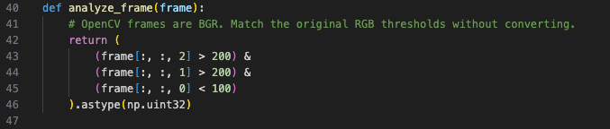
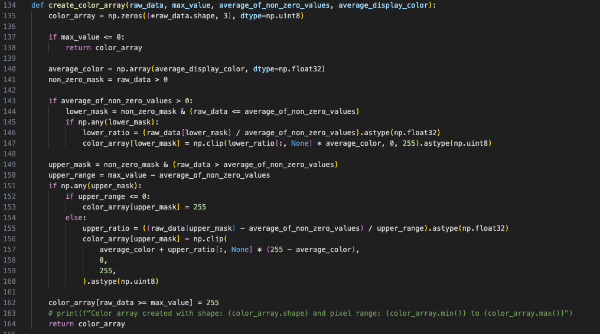
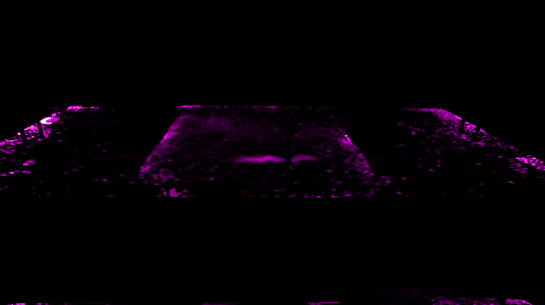
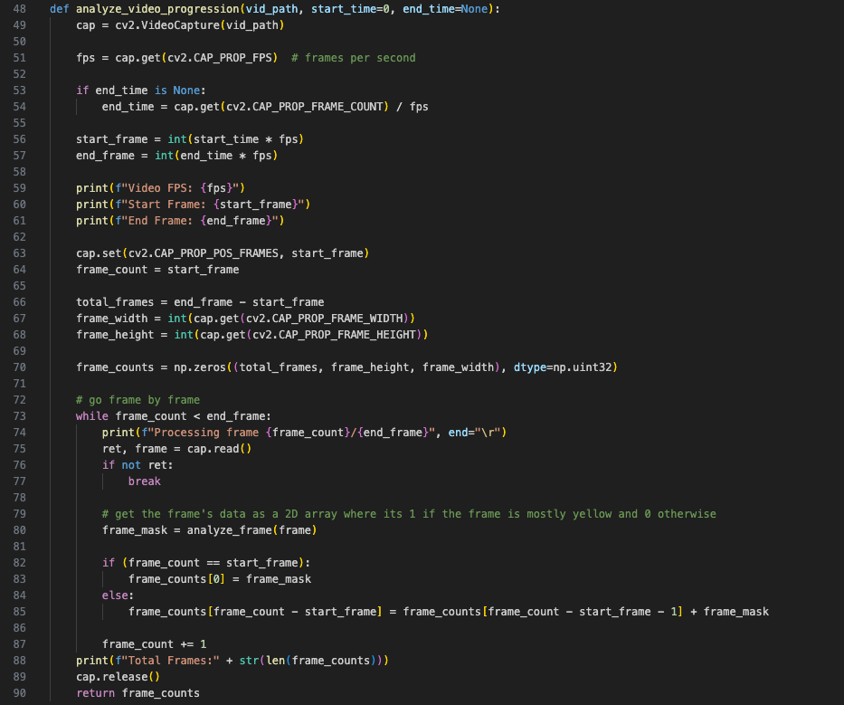

# MIT Maker Portfolio
This is my (Max Swanson's) MIT Maker Portfolio

The source-controlled versions of the programs can be found here.
* Shoot-On-The-Move: https://github.com/frc2052/2026-Rebuilt
  * The file ProjectileHelper.java is where the generalized algorithms are stored.
* Fuel Density Maps: https://github.com/MrNosnaws/fuel-density-map

## Shoot-On-The-Move (SOTM)

The goal any aiming algorithm is to provide a set of parameters that, when applied to the robot, will allow for projectiles to be fired such that they intersect a goal state. My SOTM algorithm however, generalizes this from working for a non-moving robot (static) to one that is in motion.

### Math Model

The mathematical model for this SOTM algorithm assumes two things:
1. There is some already known function that for some set location relative to the target position (on the xy plane of the field that the robot is on), returns the necessary parameters for the robot to make such a shot assuming it is static. The input to this function will be denoted as $\vec{S}$.
2. For some $\vec{S}$, there is a function that outputs the time that shot will take. This will be denoted as $t_s$

Additionally, the robots velocity ($\vec{v_R}$) is known, and the xy velocity vector of the shot can be derived by $\vec{v_S}=\frac{\vec{S}}{t_s}$. $\vec{S_v}$ will denote the final shot displacement and is the sum of the shot vector and the robot's velocity vector scaled by the shot time.

The main reason for SOTM can be seen with a diagram of these vectors (Please note that this diagram, and all the others here are NOT to scale, I've exaggerated everything as the actual data from the robot makes everything far more cluttered).

As you can see, with the added robot velocity, the final shot vector will miss the target. The first thought I had when I got to this point in the problem was to try and find a new starting shot vector that when applied, would have the final shot vector end at the target, so I tried scaling the velocity vector by the shot time and applying that to the robot's position. However, the shot time used to scale the velocity vector (here denoted as $t_{s\text{-}0}$) does not equal the shot time for the new shot vector ($t_{s\text{-}1}$).

While this attempt failed, it is MUCH closer to ending up at the target. Instead, the goal becomes to find some time $t$ such that $t\vec{v_R}+t\vec{v_S}=\vec{S_v}$

My solution does this through a sequence, the eventual goal of which is $t_{s\text{-}n}$ such that $t_{s\text{-}n} \approx t_{s\text{-}(n-1)}$. (Technically, in the limit, the goal would be for these to be equal, but as the robot's computation power is finite, they just need to be close).

My solution starts with an initial guess, $t_{s\text{-}0}$, at finds the shot time at the scaled velocity vector's coordinates, $t_{s\text{-}1}$ and then looks at the error between these two times, $\Delta t = t_{s\text{-}0} - t_{s\text{-}1}$. If $\Delta t > 0$ than the guess has overshot, if $\Delta t <0$ than it undershot ($\Delta t=0$ is the exact solution). It then finds our new value of $t_{s\text{-}0}$ based on this ($t_{s\text{-new}}=t_{s\text{-}0}-\Delta t$, this is equivalent to just $t_{s\text{-}1}$ but it will come in handy later when a correction term is needed). That new value is then plugged back into this formula again and again until $\Delta t$ is less than the allowable error.

#### A note on convergence

It would pain my pure math heart if I didn't include a little bit about whether or not this solution with converge on a solution. While I have not rigorously proven it, if you add the additional assumptions that the shot time function is continuous and the closer the robot is to the target, the less time it takes (both of which are obviously true) than it does converge quite quickly on the desired outcome. Through testing, I found it usually only requires 3 or so terms to get within the allowable error tolerance.

### Implementation

Both the shot parameter and shot time functions in the math model are represented as an interpolated look up table that is manually tuned to the robot. The shot parameter LUT was tuned by carefully finding the ideal parameters at half meter increments. The shot time LUT was tuned by taking videos of these increments and averaging how long each shot took to become scored. Additionally, through testing it was discovered that the algorithm would occasionally get stuck oscillating between two time values so $\Delta t$ was scaled by 0.8 in order to allow these to spiral inwards (This solution did not seem to add any other oscillations, which was a concern at the time). The new formula for $t_{s\text{-new}}$ at this point became $t_{s\text{-new}}=t_{s\text{-}0}-0.8\Delta t$.

Also, the actual method that implements this sequence doesn't use the exact same math as derived here, though they are equivalent. A demonstration of this in action can be found in the video accompanying this repository

## Fuel Density Maps

The idea behind the Fuel Density Maps analyzer was to take match videos that FIRST, the company running these competitions, post freely on the internet, and turn them into a map that shows where Fuel (the game object in 2026) are most prevalent on the field throughout the match.

### Analyzer

The process starts by blocking out parts of the video that might be yellow, that shouldn't be counted (e.g. the crowd, shift indicator, etc.) Then, the program break each video down into its components.
1. Full video to be analyzed, settings.py file denote start time, end time, and video link.
2. Each frame to within the video, used to find the percentage of time each pixel is "yellow".
3. Each pixel that has it's RGB (the code works in BRG, but I will just state RGB in this overview) value checked to determine whether or not it's "yellow."

Now, I will give a bit of a disclaimer, yellow is hard to define. My program has a very narrow sense of what it is which sometimes means it will miss some fuel, but it means that it doesn't pick up on other yellow things like the refs shirt (mostly). Other people have forked my repo and changed that setting, with some extending it far enough that pure white is considered yellow.

After this is where things start to differ, depending on the desired output, the next steps change.

### Image Output

If a map image is selected as the desired output, the analyzer will iterate through every frame and create a running total for each pixel of how many frames are yellow and then turn that into a percentage of how often it was yellow during the video.

Once the video has been processed, it then converts these values into a map. This is displayed through a gradient: Black -> Magenta -> White, where the whitest pixel is the one with the highest density, all pure black pixels have 0 density, and the Magenta pixel point can be custom set for higher/lower sensitive maps.

These arrays are then output into these maps.

There is also a feature that will create a combination map from a bunch of videos. This works the exact same way, just with more overall frames to check.

### Video Output

The goal in the video processing is to determine how the density of fuel change over the course of a match, which is done by outputting a video that depicts a running total of the map up until that frame in the video. As you might expect, the process is very similar to the image pipeline.

An example output of this, overlaid onto the match it came from can be found in the accompanying video in this application submission.

### Strategic Value

As previously stated, the point of this program was to provide strategic incites on the 2026 FRC game. Generally, this tool reveals that in most matches there are three high density regions on the field. The first is obvious with out the tool: The center of the field is where all the game objects start so at the beginning of that match, that is the high density area. However, in the last 30 seconds, it also can fairly dense. This is because fuel is exiting both alliance's Hubs at the same time and mixing in the middle of the field. The next high density area is the alliance station walls (the far left and right walls from the camera's perspective). This is due to the common strategy of firing the fuel back to a team's own alliance zone in preparation for scoring. However, they specifically clumped against the back wall which appears to because that is the first thing stopping the fuels momentum once it lands. Finally, large clumps can be seen lined up along walls and field elements. This appears to be for the same reason as for the clumps along the alliance station: being in the way. I wrote a much more in-depth write up during the season with lots of community feedback here: https://www.chiefdelphi.com/t/fuel-density-maps/517029